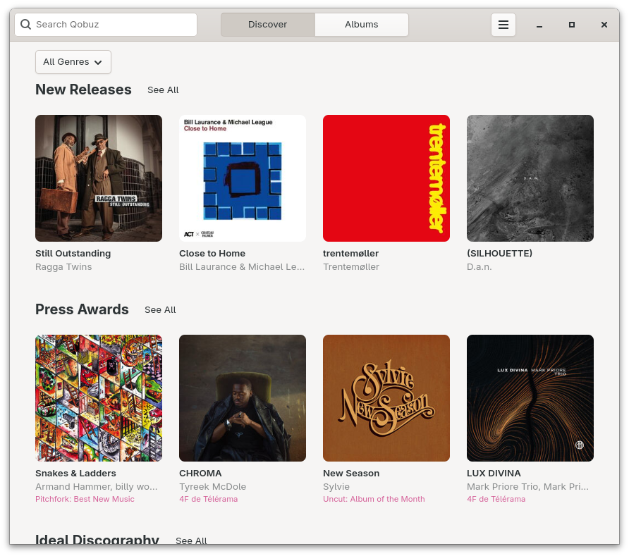

# Pochette

A native Linux player for [Qobuz](https://www.qobuz.com), built around albums: your library of whole albums, played from the first track to the last.

Requires a paid Qobuz subscription. Pochette uses the Qobuz API but is not certified by Qobuz
and is not affiliated with Qobuz.

## Screenshots

<p align="center">
  
  
</p>

## Features

- **Albums**: your saved albums, to search, filter by genre and decade, sort, or play at random
- **Discover**: Qobuz's new releases, press awards and ideal discography, by genre
- **Lyrics** that follow the song, looked up on [LRCLIB](https://lrclib.net) while you show them
- **Hi-Res** streaming, up to what your subscription allows
- **Media keys** and desktop media controls, through MPRIS
- Your desktop's **accent color**, light and dark modes

Pochette is built with GTK 4 and Relm4.

## Install

### Nix

```sh
nix run github:mcrampon/pochette
```

or add `github:mcrampon/pochette` as a flake input and install its `packages.<system>.default`.

### From source

You need Rust 1.95 or later, the development files of GTK 4 (4.14 or later) and GStreamer
with its base and good plugins, and `cmake`, a C compiler and `pkg-config` to build the TLS
library (no OpenSSL needed). Then:

```sh
make
sudo make install    # into /usr/local; set PREFIX and DESTDIR to change it
```

Streaming over HTTPS also needs GLib's TLS support at runtime (`glib-networking`).

## Signing in

Signing in happens in your default browser, on Qobuz's own page, so your saved password or
SSO provider just works. Pochette catches the redirect on a loopback port and keeps the session
in your keyring through the Secret Service API (GNOME Keyring, KWallet, KeePassXC…), or in
`$XDG_DATA_HOME/pochette/session.json` (readable only by you) when no keyring runs.

Pochette talks to Qobuz the way its web player does, with the web player's own credentials.
Qobuz could change that at any time, which would break Pochette until it's updated.

## Privacy

Pochette talks to Qobuz, and to nobody else, except for lyrics: while you show them, it sends
the title, artist, album and length of the track playing to [LRCLIB](https://lrclib.net) to
find them. Covers are cached in `$XDG_CACHE_HOME/pochette`.

## Layout

- `crates/qobuz`: Qobuz API client, with no UI code (app id discovery, browser sign-in, API calls)
- `crates/pochette`: the application (GTK 4 + Relm4)
- `data`: the desktop file, icons, AppStream metainfo and screenshots

## Development

```sh
nix develop          # or any Rust ≥ 1.95 toolchain with the libraries above
cargo run
cargo test           # add `-- --include-ignored` to also check against the live services
```

## License

[GPL-3.0-or-later](LICENSE)
