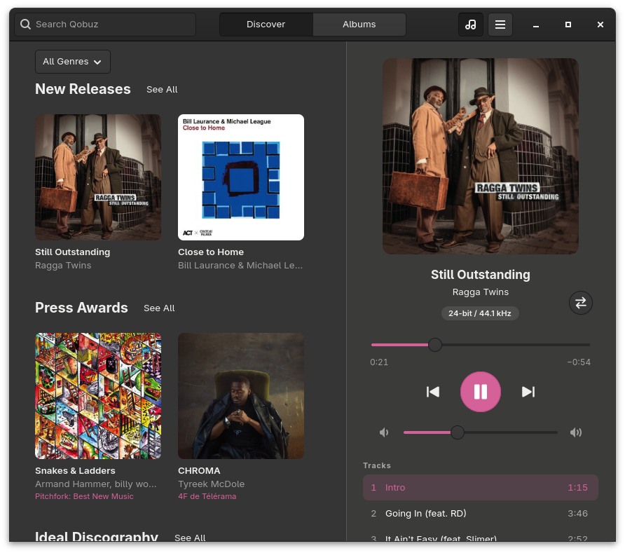

# Pochette

A native Linux player for [Qobuz](https://www.qobuz.com), built around albums: your library of whole albums, played from the first track to the last.

Requires a paid Qobuz subscription. Pochette uses the Qobuz API but is not certified by Qobuz
and is not affiliated with Qobuz.

## Screenshots

<p align="center">
  
  
</p>

## Features

- **Albums**: your saved albums, to search, filter by genre and decade, sort, or play at random
- **Discover**: Qobuz's new releases, press awards and ideal discography, by genre
- **Listening stats**: your top albums, artists and genres, and how much you listened, by
  month or year
- **Devices**: your plays synced between your computers on the same network, even while
  Pochette is closed
- **Lyrics** that follow the song, looked up on [LRCLIB](https://lrclib.net) while you show them
- **Hi-Res** streaming, up to what your subscription allows
- **Media keys** and desktop media controls, through MPRIS
- Your desktop's **accent color**, light and dark modes

Pochette is built with GTK 4 and Relm4.

## Install

### Nix

```sh
nix run github:mcrampon/pochette
```

or add `github:mcrampon/pochette` as a flake input and install its `packages.<system>.default`.

### From source

You need Rust 1.95 or later, the development files of GTK 4 (4.14 or later) and GStreamer
with its base and good plugins, and `cmake`, a C compiler and `pkg-config` to build the TLS
library (no OpenSSL needed). Then:

```sh
make
sudo make install    # into /usr/local; set PREFIX and DESTDIR to change it
```

Streaming over HTTPS also needs GLib's TLS support at runtime (`glib-networking`).

## Signing in

Signing in happens in your default browser, on Qobuz's own page, so your saved password or
SSO provider just works. Pochette catches the redirect on a loopback port and keeps the session
in your keyring through the Secret Service API (GNOME Keyring, KWallet, KeePassXC…), or in
`$XDG_DATA_HOME/pochette/session.json` (readable only by you) when no keyring runs.

Pochette talks to Qobuz the way its web player does, with the web player's own credentials.
Qobuz could change that at any time, which would break Pochette until it's updated.

## Syncing devices

Devices, in the main menu, pairs this computer with your others: open it on both, on the same
network, pick the other one, and check that both show the same code. From then on, they send
each other the plays the other lacks whenever they're on the same network, over an encrypted
connection only they can open ([Noise](https://noiseprotocol.org), with each computer's own
key).

A small service, `pochette --sync`, does it, with no window. It runs while Pochette is open,
and, unless you turn it off in Devices, while it's closed: it then starts with your session,
from an [XDG autostart](https://specifications.freedesktop.org/autostart-spec/latest/) entry
in `$XDG_CONFIG_HOME/autostart`. Desktops that don't read those, as some tiling window managers,
need `pochette --sync` added to their own startup.

Computers find each other with mDNS, and sync over TCP. A firewall must let through:

- TCP port 45617, to sync
- UDP port 5353 (mDNS), to find each other; without it, pair by address instead

Some networks keep their devices apart, as many public and guest Wi-Fi networks do: there,
computers can't sync.

## Privacy

Pochette talks to Qobuz, and to nobody else, except for lyrics: while you show them, it sends
the title, artist, album and length of the track playing to [LRCLIB](https://lrclib.net) to
find them. Covers are cached in `$XDG_CACHE_HOME/pochette`.

What you play is logged in `$XDG_DATA_HOME/pochette`, for the stats and to sort albums by
plays. It stays on your computers: only those you pair get it, over your local network. Each
computer writes its own file, so syncing that folder by other means, as with Syncthing, adds
up their plays too. Each computer's key and the computers it's paired with are kept in
`$XDG_STATE_HOME/pochette`.

While paired, or while Devices is open, Pochette announces itself on the local network, with
the computer's name, for the others to find it.

## Layout

- `crates/qobuz`: Qobuz API client, with no UI code (app id discovery, browser sign-in, API calls)
- `crates/pochette`: the application (GTK 4 + Relm4)
- `data`: the desktop file, icons, AppStream metainfo and screenshots

## Development

```sh
nix develop          # or any Rust ≥ 1.95 toolchain with the libraries above
cargo run
cargo test           # add `-- --include-ignored` to also check against the live services
```

## License

[GPL-3.0-or-later](LICENSE)
