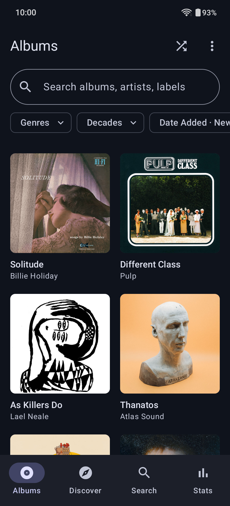
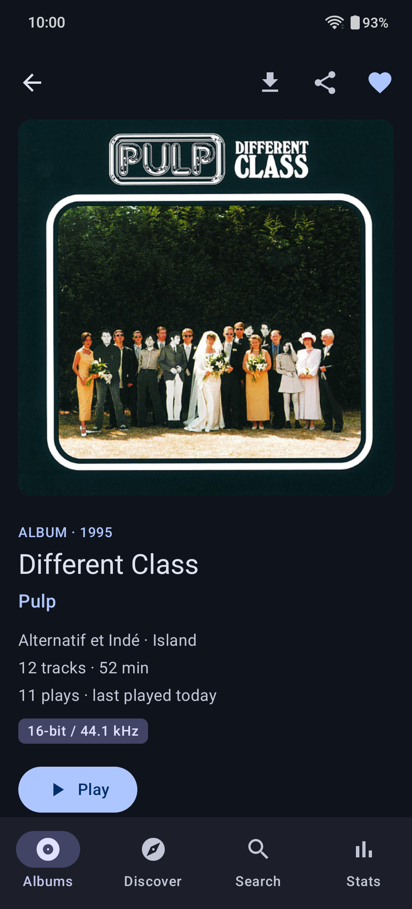
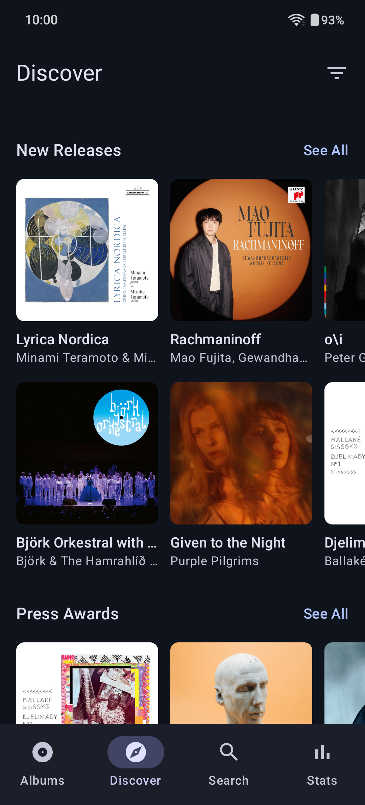
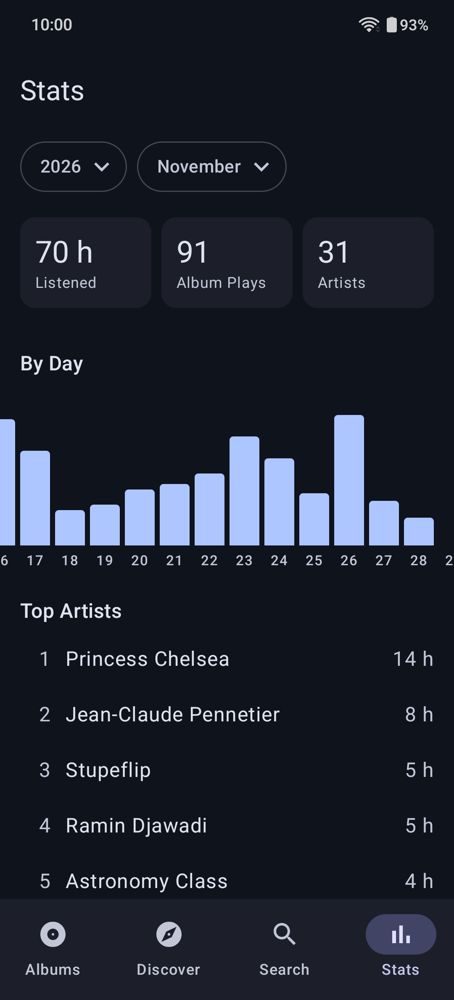

# Pochette

A [Qobuz](https://www.qobuz.com) player for Linux and Android, built around albums: your library of whole albums, played from the first track to the last.

Requires a paid Qobuz subscription. Pochette uses the Qobuz API but is not certified by Qobuz
and is not affiliated with Qobuz.

## Screenshots

<p align="center">
  
  
</p>
<p align="center">
  
  
  
  
</p>

## Features

- **Albums**: your saved albums, to search, filter by genre and decade, sort, or play at random
- **Discover**: Qobuz's new releases, press awards and ideal discography, by genre
- **Takes up where you left off**: reopened, Pochette has the album you were playing ready,
  paused where you were in the track
- **Listening stats**: your top albums, artists and genres, and how much you listened, by
  month or year
- **Devices**: your plays synced between your computers and your phone on the same network,
  even while Pochette is closed
- **Lyrics** that follow the song, looked up on [LRCLIB](https://lrclib.net) while you show them
- **Hi-Res** streaming, up to what your subscription allows
- **Plays reported to Qobuz**, as its own apps do, so the artists get paid for what you hear
- **Media keys** and desktop media controls, through MPRIS; on Android, the system's media
  controls, headphones and cars
- Your desktop's **accent color**, light and dark modes

The desktop app is built with GTK 4 and Relm4, the Android app with Jetpack Compose and Media3.
They share a core written in Rust: the play history, stats, library sorting and syncing.

## Install

### Nix

```sh
nix run github:mcrampon/pochette
```

or add `github:mcrampon/pochette` as a flake input and install its `packages.<system>.default`.

### From source

You need Rust 1.95 or later, the development files of GTK 4 (4.14 or later) and GStreamer
with its base and good plugins, and `cmake`, a C compiler and `pkg-config` to build the TLS
library (no OpenSSL needed). Then:

```sh
make
sudo make install    # into /usr/local; set PREFIX and DESTDIR to change it
```

Streaming over HTTPS also needs GLib's TLS support at runtime (`glib-networking`).

### Android

Android 10 or later. Download the APK of the latest `android-v…` release on
[GitHub](https://github.com/mcrampon/pochette/releases) and open it on your phone. The Android
app has its own version numbers, apart from the desktop's.

## Signing in

Signing in happens in your default browser, on Qobuz's own page, so your saved password or
SSO provider just works; on Android, the browser then brings you back to the app. On Linux,
Pochette catches the redirect on a loopback port and keeps the session
in your keyring through the Secret Service API (GNOME Keyring, KWallet, KeePassXC…), or in
`$XDG_DATA_HOME/pochette/session.json` (readable only by you) when no keyring runs.

Pochette talks to Qobuz the way its web player does, with the web player's own credentials.
Qobuz could change that at any time, which would break Pochette until it's updated.

## Opening Qobuz links

Pochette opens Qobuz's links to albums and artists, as Qobuz shares them
(`https://open.qobuz.com/album/…`). A link to a single track leads to its album: Pochette
plays albums, whole.

- **Linux:** Pochette opens the `qobuzapp://` links that Qobuz's pages hand to its desktop
  app, so a Qobuz link clicked anywhere opens in Pochette, through the browser. `pochette`
  also takes a link on the command line, and hands it to the Pochette already open.
- **Android:** share a Qobuz link to Pochette, from Qobuz's app or anywhere else. For links
  to open in Pochette when tapped, allow them once in Android's settings: Apps › Pochette ›
  Open by default › Add links. Only Qobuz could let Android do it on its own.

## Paying the artists

Qobuz pays artists and labels for their plays, from what its apps tell it was heard. Pochette
tells it the same way, on Linux and Android: when a track starts, then each stretch of it you
listened to, up to a pause, a seek or the next track. So what you play in Pochette counts for
the artists just as it would in Qobuz's own apps.

## Syncing devices

The Devices section of Settings, in the main menu, pairs this computer with your others: open
it on both, on the same network, pick the other one, and check that both show the same code.
From then on, they send each other the plays the other lacks whenever they're on the same
network, over an encrypted connection only they can open
([Noise](https://noiseprotocol.org), with each computer's own key).

A small service, `pochette --sync`, does it, with no window. It runs while Pochette is open,
and, unless you turn it off in Settings, while it's closed: it then starts with your session,
from an [XDG autostart](https://specifications.freedesktop.org/autostart-spec/latest/) entry
in `$XDG_CONFIG_HOME/autostart`. Desktops that don't read those, as some tiling window managers,
need `pochette --sync` added to their own startup.

Computers find each other with mDNS, and sync over TCP. A firewall must let through:

- TCP port 45617, to sync
- UDP port 5353 (mDNS), to find each other; without it, pair by address instead

Some networks keep their devices apart, as many public and guest Wi-Fi networks do: there,
computers can't sync.

On Android, Settings is in the Albums tab's menu, and pairs the same way. The phone syncs while
the app is open or playing, and, unless you turn it off, every 15 minutes or so on Wi-Fi with
the app closed, as often as Android lets it.

## Privacy

Pochette talks to Qobuz, and to nobody else, except for lyrics. Qobuz hears what you play, as
with its own apps: see [Paying the artists](#paying-the-artists). For lyrics, while you show
them, Pochette sends the title, artist, album and length of the track playing to
[LRCLIB](https://lrclib.net) to find them. Covers are cached in `$XDG_CACHE_HOME/pochette`.

What you play is logged in `$XDG_DATA_HOME/pochette`, for the stats and to sort albums by
plays. It stays on your computers: only those you pair get it, over your local network. Each
computer writes its own file, so syncing that folder by other means, as with Syncthing, adds
up their plays too. Each computer's key and the computers it's paired with are kept in
`$XDG_STATE_HOME/pochette`.

While paired, or while Settings is open, Pochette announces itself on the local network, with
the computer's name, for the others to find it.

On Android, the plays are kept in the app's own storage, and go with Android's backup of the
app's data, if you have it on. The Qobuz session, encrypted with a key kept in the phone's
keystore, and the phone's sync key stay on the phone.

## Layout

- `crates/qobuz`: Qobuz API client, with no UI code (app id discovery, browser sign-in, API calls)
- `crates/pochette-core`: what both apps share: the play history and stats, the library's
  sorting and filters, lyrics, and syncing
- `crates/pochette`: the desktop application (GTK 4 + Relm4)
- `crates/pochette-ffi`: the core as the Android app calls it, through
  [UniFFI](https://mozilla.github.io/uniffi-rs/)
- `android`: the Android app (Kotlin, Jetpack Compose, Media3)
- `data`: the desktop file, icons, AppStream metainfo and screenshots
- `fastlane`: the Android app's store listing, as F-Droid reads it

## Development

```sh
nix develop          # or any Rust ≥ 1.95 toolchain with the libraries above
cargo run
cargo test           # add `-- --include-ignored` to also check against the live services
```

### Android

The Android app builds the core for each ABI with [cargo-ndk](https://github.com/bbqsrc/cargo-ndk)
and generates its Kotlin bindings, as part of the Gradle build. `nix develop .#android` has the
SDK, the NDK, Gradle and the Rust targets; elsewhere, you need those, with the versions in
`android/app/build.gradle.kts`, and `cargo-ndk`.

```sh
nix develop .#android
gradle -p android :app:assembleDebug                         # or ./gradlew in android/
gradle -p android :app:assembleDebug -Ppochette.abis=x86_64  # just the emulator's ABI
gradle -p android :app:testDebugUnitTest :app:lintDebug
```

To release version X.Y.Z of the Android app: set `pochette.version` in
`android/gradle.properties`, write `fastlane/metadata/android/en-US/changelogs/<versionCode>.txt`
(1.2.3 is 10203), commit, and tag `android-vX.Y.Z`. The release build is signed when
`pochette.signing`, in `~/.gradle/gradle.properties`, names a properties file with `storeFile`,
`storePassword`, `keyAlias` and `keyPassword`; else it's unsigned, as F-Droid wants it.

```sh
gradle -p android :app:assembleRelease   # android/app/build/outputs/apk/release
```

The same sources give the same APK, wherever they're built with the same tools.

## License

[GPL-3.0-or-later](LICENSE)
